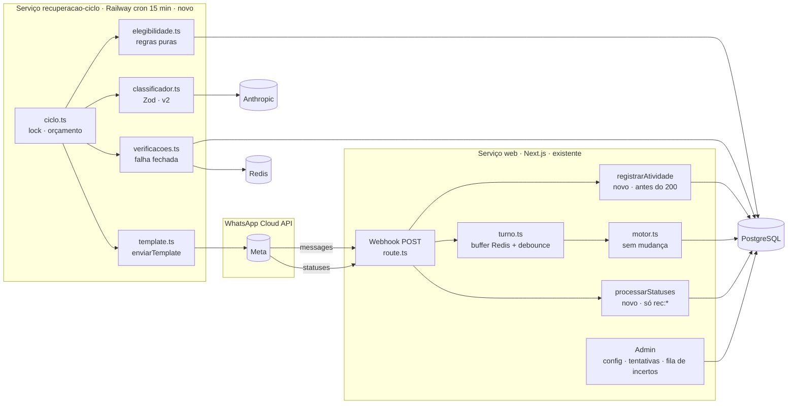
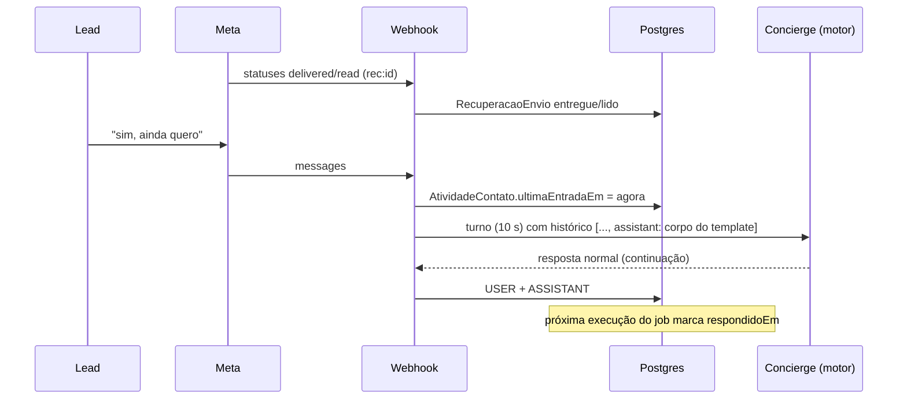
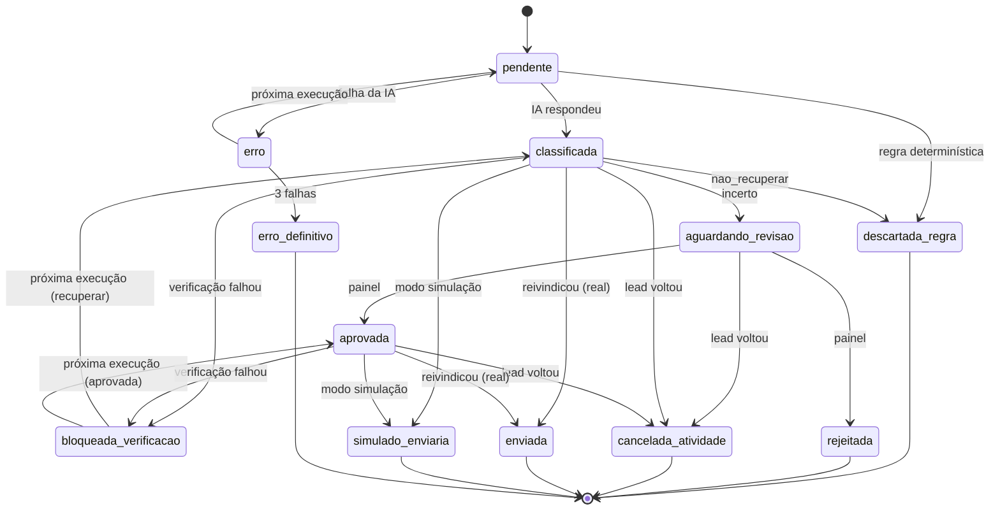
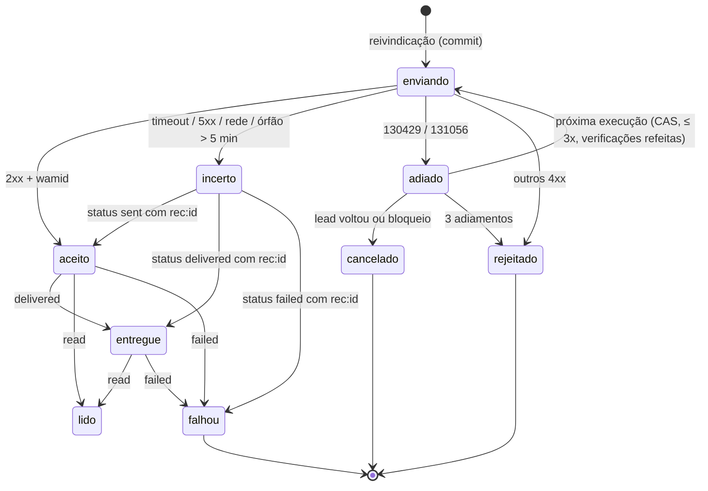

# T01 — Arquitetura técnica · Lead Recovery

Tarefa só de arquitetura. Nenhum código, schema, migração, prompt, configuração do Railway ou dado foi alterado. Este arquivo é a única mudança.

- **Base:** branch `dev`, commit `62395ff` (T00), em 2026-11-04.
- **Entrada:** `docs/lead-recovery/T00_RECONHECIMENTO.md`, confirmado no código (`src/app/api/whatsapp/webhook/route.ts`, `src/lib/whatsapp/{send,turno,conversa,phone}.ts`, `src/lib/atendimento/motor.ts`, `src/lib/ai/{validate-output,build-prestador-prompt,registro}.ts`, `src/lib/eventos.ts`, `recuperacao/*`, `prisma/schema.prisma`).

## Legenda

| Etiqueta | Significado |
|---|---|
| **[APROVADO]** | Decisão de produto já fechada (D1–D5 do enunciado e ajustes A1–A4 da revisão do plano). Não se rediscute aqui. |
| **[PROPOSTA]** | Decisão técnica ou parâmetro recomendado nesta T01. Precisa de aceite para virar regra. |
| **[CONFIRMADO]** | Lido no código desta base. |
| **[VERIFICAR NO AMBIENTE]** | Depende de Meta, Railway ou ambiente real; não pode ser presumido. |

---

## 1. Resumo executivo

O Lead Recovery será um **job periódico isolado** (serviço Railway com cron a cada 15 min) que lê o banco, decide quem recuperar e envia **um template aprovado** pela Cloud API. O atendimento (web + webhook) ganha só duas mudanças pequenas e defensivas: **gravar a hora da última entrada do lead na chegada** e **ler os `statuses` da Meta** para as mensagens de recuperação. O motor de atendimento e o prompt não mudam na primeira entrega.

Pilares:

1. **Uma tentativa real por contato, garantida pelo banco** — `@@unique([clienteId, numeroContato])` numa tabela só de envios reais. Simulação grava em outro lugar e não consome a tentativa.
2. **Falha fechada** — se o sistema não consegue confirmar que o lead está calado há 24h (Redis fora, marca de atividade ausente, falha registrada no webhook, buffer de turno pendente), **não envia** e tenta na próxima execução.
3. **Reivindicar antes de chamar a Meta** — a tentativa é gravada (e trancada contra corrida) antes do HTTP. Resultado desconhecido vira `incerto` e **nunca é reenviado**.
4. **Aceito ≠ entregue** — o estado da tentativa segue os `statuses` (`sent`, `delivered`, `read`, `failed`); o histórico do Concierge só recebe a mensagem quando a Meta aceitou, e perde a linha se a entrega falhar, sem perder a auditoria.
5. **Classificação permissiva, mas sem poder de decisão final** — a IA decide `recuperar` / `nao_recuperar` / `incerto`; regras determinísticas vêm antes e depois. `incerto` vai para uma fila de revisão no painel.

Custo: um serviço que só existe enquanto roda, uma chamada de IA barata por ciclo de inatividade e a tarifa de template de marketing da Meta por mensagem entregue.

---

## 2. Requisitos

### 2.1 Funcionais

| # | Requisito | Origem |
|---|---|---|
| RF1 | Avaliar a recuperação quando completar 24h desde a última mensagem recebida do lead | [APROVADO] D1 |
| RF2 | Antes de enviar, verificar se houve nova mensagem ou evento que torne a recuperação inadequada | [APROVADO] D1 |
| RF3 | Não usar `WhatsappConversation.updatedAt` como atividade | [APROVADO] D1 |
| RF4 | Sem prazo máximo desde a última mensagem: passou de 24h, é elegível | [APROVADO] A1 |
| RF5 | IA classifica em `recuperar`, `nao_recuperar`, `incerto`; critério permissivo ("oi", pergunta genérica e interesse plausível = `recuperar`) | [APROVADO] D2 + A1 |
| RF6 | `recuperar` envia automaticamente, sem aprovação humana individual | [APROVADO] D2 |
| RF7 | `incerto` vai para fila no painel; aprovado manualmente só envia depois de revalidar a elegibilidade | [APROVADO] A2 |
| RF8 | `nao_recuperar` nunca envia | [APROVADO] D2 |
| RF9 | Uma única tentativa **real** por contato por cliente, para sempre; não reinicia por conversa nova, nova inatividade ou reativação do módulo | [APROVADO] D3 + A4 |
| RF10 | Um template aprovado pela Meta, sem botões, configurável por cliente; a IA não gera texto | [APROVADO] D4 |
| RF11 | Modo simulação sem envio real; simulação não conta como tentativa | [APROVADO] D5 + A4 |
| RF12 | Sem limites diários artificiais; processar todos os elegíveis respeitando limites técnicos e da Meta | [APROVADO] A3 |
| RF13 | Registrar a mensagem enviada no histórico para o Concierge continuar o atendimento | Enunciado §E |
| RF14 | Opt-out e bloqueio por contato | Enunciado §B |
| RF15 | Auditoria completa de cada decisão e envio | Enunciado §B + A4 |

### 2.2 Não funcionais

| # | Requisito |
|---|---|
| RNF1 | Isolamento do atendimento: falha do Recovery nunca derruba nem atrasa o Concierge |
| RNF2 | Migrações só aditivas, compatíveis com produção (`migrate deploy` roda a cada boot) |
| RNF3 | Falha fechada: dúvida sobre atividade recente bloqueia o envio |
| RNF4 | Prevenir duplicidade acima de aproveitar oportunidade |
| RNF5 | Retomável após reinício em qualquer ponto, sem reenvio |
| RNF6 | Testável offline (relógio, Meta e IA injetáveis) e em staging antes de qualquer envio real |
| RNF7 | Baixo custo operacional e manutenção simples (mesmo repositório, mesmo Prisma) |
| RNF8 | Isolamento entre clientes (dados, credenciais, configuração) |
| RNF9 | Nenhum dado de lead em log/evento; texto só nas tabelas próprias |

---

## 3. Decisões arquiteturais e trade-offs

### A. Execução e infraestrutura

| Alternativa | Vantagens | Desvantagens | Custo / manutenção / confiabilidade |
|---|---|---|---|
| **A1. Serviço Railway separado com Cron Schedule** | Isolado do web; processo curto (sem vazamento de memória); deploy independente; Railway **pula** a execução se a anterior ainda estiver ativa; mínimo de 5 min entre execuções | Precisão de alguns minutos (Railway não garante o minuto exato); horários em UTC; precisa terminar o processo; cold start a cada execução | Paga só o tempo de execução. Mesmo código e Prisma. Falha de uma execução não afeta a próxima |
| A2. Worker persistente (loop com `sleep`) | Latência menor; sem cold start | Custo fixo 24/7; precisa de própria proteção contra travamento; reinício no meio do loop | Ligeiramente mais caro; mesma confiabilidade se tiver as mesmas travas |
| A3. Agendamento dentro do Next.js (`setInterval`) | Zero infraestrutura nova | Duplica com réplicas; morre a cada deploy; compete por CPU/conexões com o atendimento; o `instrumentation.ts` já foi removido (T7) | Barato, mas viola RNF1 |

**[PROPOSTA] A1 — serviço separado com cron.** Detalhes:

- **Periodicidade:** `*/15 * * * *` (UTC). Uma recuperação sai entre 24h e ~24h15 (mais a variação do Railway), o que é irrelevante para o produto. 5 min é possível, mas multiplica execuções vazias sem ganho.
- **Comando:** `npm run recuperacao:ciclo` (novo script). Build: `npm ci && npx prisma generate`. **Nunca** `npm start` (aplicaria migrações e subiria o web). As migrações continuam aplicadas só pelo serviço web.
- **Trava por execução:** `pg_try_advisory_lock(<constante>)` no início. Não conseguiu → sai com código 0 e evento. Protege contra execução manual e redeploy durante uma execução (o redeploy não passa pelo agendador). Lock de sessão é liberado se o processo morrer.
- **Orçamento de tempo:** cada execução para de pegar trabalho novo após ~10 min e termina. Isso é limite técnico (não deixar uma execução encostar na próxima), não teto de volume: o que sobrar continua na próxima.
- **Falhas:** erro de conexão com o banco → sai com código ≠ 0 (Railway mostra falha), nada é perdido porque o estado está no banco. Erro numa conversa → registra na avaliação e segue para a próxima. O web não depende do job.
- **Credencial:** `DATABASE_URL` própria do serviço. **[PROPOSTA]** role Postgres dedicada com `SELECT` nas tabelas do atendimento, `INSERT/UPDATE` nas tabelas do Recovery e `INSERT/DELETE` em `WhatsappMessage` (histórico) — **[VERIFICAR NO AMBIENTE]** se o Postgres do Railway permite criar a role.
- **[VERIFICAR NO AMBIENTE]** Cron disponível no plano; número de réplicas do web (o webhook continua exigindo 1 réplica por causa do debounce em memória).

### B. Modelo de dados

| Alternativa | Vantagens | Desvantagens |
|---|---|---|
| B1. Colunas novas em `Cliente`, `WhatsappConversation`, `WhatsappMessage` | Menos tabelas; consultas diretas | Mexe em tabelas quentes; unicidade "por contato para sempre" não cabe em `WhatsappConversation` (que pode ser apagada); `WhatsappMessage` é a maior tabela |
| **B2. Tabelas próprias** | Migração 100% aditiva; módulo removível; unicidade independente da conversa; auditoria fica com o módulo | Joins; configuração separada do cadastro |

**[PROPOSTA] B2 — cinco tabelas novas, nenhuma coluna em tabela existente.** Detalhe na seção 5.

- A regra D3 vira `@@unique([clienteId, numeroContato])` em `RecuperacaoEnvio`, que só recebe **tentativas reais**. A chave usa `numeroContato` normalizado por `normalizarNumero` (mesma regra do atendimento, incluindo o nono dígito) e **não** depende da conversa: `conversaId` é `onDelete: SetNull`, então apagar a conversa não reabre a elegibilidade.
- Simulação grava o desfecho em `RecuperacaoAvaliacao` e nunca cria `RecuperacaoEnvio` (A4).
- `mensagemId` (linha do histórico) é texto sem FK: permite remover a linha do histórico em falha de entrega sem apagar a auditoria e evita FK sobre `WhatsappMessage`.

### C. Identificação de atividade

| Alternativa | Vantagens | Desvantagens |
|---|---|---|
| C1. `max(WhatsappMessage.createdAt where USER)` | Já existe | Gravado no fim do turno (10 s + IA); mídia só, figurinha, reação e botão **não são gravados**; turno perdido em reinício não deixa rastro **[CONFIRMADO]** |
| C2. Chave Redis por contato | Rápida | Redis não é persistência garantida; some em falha |
| C3. Coluna em `WhatsappConversation` | Perto dos dados | A conversa só nasce no fim do primeiro turno; `update` mexe em `updatedAt` (que o admin mostra como "Última atividade") |
| **C4. Tabela `AtividadeContato` escrita na chegada do webhook** | Registra **toda** entrada, de qualquer tipo, antes do buffer e da IA; sobrevive a reinício; não toca tabelas existentes | Uma escrita a mais no hot path do webhook |

**[PROPOSTA] C4, com falha fechada.**

1. **Onde grava:** no `POST` do webhook, **antes de responder 200**, para cada `message` com `id` e `from` — **antes** do filtro de tipo (figurinha, reação, localização, `button`, `interactive` também contam) e independentemente do dedupe. Upsert por `(clienteId, numeroContato)` com `ultimaEntradaEm = GREATEST(atual, now())` e `ultimaEntradaMetaTs = GREATEST(atual, message.timestamp)`. Hoje o processamento roda depois do 200 (`route.ts` l. 111–118); gravar antes elimina a perda por reinício entre o 200 e o processamento.
2. **Se a gravação falhar:** o webhook responde 200 mesmo assim (o atendimento tem prioridade) e registra o evento `recuperacao_atividade_falha` com `clienteId`. Esse evento **bloqueia os envios daquele cliente** até que haja uma execução sem falhas novas desde a referência.
3. **Reentrega antiga da Meta** (até 7 dias) atualiza `ultimaEntradaEm` para o momento do recebimento: atrasa a recuperação, nunca adianta. Direção segura.
4. **Referência do ciclo:** `referenciaEm = ultimaEntradaEm`. A Meta `timestamp` fica para auditoria e como segunda checagem (qualquer uma das duas acima da referência cancela).
5. **Verificações antes do envio (todas obrigatórias; qualquer uma impossível ou negativa → `bloqueada_verificacao`, volta na próxima execução):**

| Verificação | Cobre |
|---|---|
| Linha de `AtividadeContato` existe e `ultimaEntradaEm == referenciaEm` | Mensagem nova de qualquer tipo, inclusive mídia e figurinha |
| `ultimaEntradaMetaTs <= referência` | Mensagem atrasada no caminho da Meta que já chegou |
| `max(USER.createdAt)` não ultrapassa `ultimaEntradaEm` + tolerância (2 min) | Atividade que não foi marcada (bug ou falha silenciosa) |
| Redis responde e não há `wa:buf:{phoneNumberId}:{fromBruto}` | Turno aguardando o debounce |
| Nenhum `recuperacao_atividade_falha` do cliente desde a referência | Webhook que não conseguiu marcar atividade |
| Banco respondeu a todas as leituras | Falha de leitura |

6. **Mensagem recebida durante a classificação:** a classificação leva segundos; a verificação acima roda depois dela, dentro da reivindicação (seção 3.D). Nova atividade → avaliação `cancelada_atividade`.
7. **Janela residual inerente:** entre o commit da reivindicação e o processamento pela Meta (≤ timeout do HTTP, 30 s) o lead pode escrever. O sistema **não sabia** no momento da decisão, então não é envio deliberado. A ocorrência é auditada (`conflitoAtividade = true` quando a atividade posterior chega antes do aceite).

### D. Concorrência e idempotência

**Reivindicação** (núcleo da garantia):

```
BEGIN
  SELECT … FROM "AtividadeContato" WHERE clienteId=$1 AND numeroContato=$2 FOR UPDATE
  -- rechecagens determinísticas (seção 6.3) + verificações de atividade (3.C)
  INSERT INTO "RecuperacaoEnvio" (clienteId, numeroContato, status='enviando', …)  -- unique
COMMIT
-- só depois: chamada HTTP à Meta (nunca com transação aberta)
```

- O `FOR UPDATE` faz o upsert de atividade do webhook esperar alguns milissegundos até o commit; depois dele, a atividade nova é vista na reconciliação (`conflitoAtividade`).
- `P2002` no `INSERT` = outro processo já reivindicou → avaliação `descartada_regra` motivo `ja_tentado`.

| Ameaça | Mecanismo | Garantido por |
|---|---|---|
| Dois processos disparando para o mesmo contato | Advisory lock por execução + `@@unique([clienteId, numeroContato])` | **Banco** |
| Reenvio após reinício do worker | Estado `enviando` gravado antes do HTTP; `enviando` com mais de 5 min vira `incerto`; nada sai de `incerto` para um novo envio | **Banco** |
| Reenvio após timeout com resultado desconhecido | Timeout, 5xx, exceção de rede, 2xx sem `wamid` → `incerto`, final para envio | **Banco** (não reenvia); **limitação**: o lead pode ou não ter recebido |
| Disparo após nova mensagem do lead | Verificações de 3.C dentro da transação com `FOR UPDATE` | **Banco** até o commit; **limitação**: janela residual de 3.C.7 |
| Duplicidade por eventos repetidos | Mensagens: dedupe Redis + `GREATEST` (idempotente). Statuses: transição monotônica. Execuções: advisory lock + unique | **Banco** |
| Dois ciclos de avaliação iguais | `@@unique([clienteId, numeroContato, referenciaEm])` em `RecuperacaoAvaliacao` | **Banco** |

**Limitações inerentes à Meta** (a Cloud API não aceita chave de idempotência no envio):

- Depois de um timeout, não há como saber se a mensagem saiu. Mitigação: `biz_opaque_callback_data = "rec:<envioId>"` no envio; o status `sent`/`delivered`/`failed` que chegar com esse valor reconcilia o `incerto`. Sem status, fica `incerto` para sempre e **não reenvia**. Pior caso: uma mensagem entregue sem linha no histórico do Concierge.
- A Meta pode aceitar e falhar depois (`failed` assíncrono, ex.: 131049).
- A Meta pode entregar com atraso (aparelho desligado). **[VERIFICAR NO AMBIENTE]** se há TTL configurável para template de marketing; se houver, usar TTL curto (ex.: 12h) para não entregar dias depois.

**Erros 4xx com corpo de erro** = a Meta recusou a requisição; comprovadamente não enviado:

- `130429` (throughput) e `131056` (limite do par contato) → envio `adiado`; a execução para de enviar e a próxima retoma **a mesma linha** por compare-and-set (`UPDATE … WHERE status='adiado'`), no máximo 3 vezes. Não é duplicidade: nada foi aceito.
- Demais 4xx (template pausado/inexistente, parâmetro, número inválido, 131050) → `rejeitado`, final. A tentativa fica consumida (RNF4).

### E. Integração com o Concierge

| Alternativa | Vantagens | Desvantagens |
|---|---|---|
| **E1. Gravar `ASSISTANT` com o corpo exato do template** | Zero mudança no motor e no prompt; já há precedente (`[documento enviado]`, gravado só depois do aceite — `route.ts` l. 444); o Concierge vê o que o lead viu | O histórico não sabe por si que foi recuperação (a auditoria sabe) |
| E2. Marcador interno no texto (`[recuperação] …`) | Explícito para a IA | Exige regra no prompt e em `LEAK_MARKERS`; risco de a IA repetir o marcador |
| E3. Coluna `origem` em `WhatsappMessage` | Estruturado | Migração na maior tabela; `carregarHistorico` e o motor precisariam ler |
| E4. Bloco de contexto `<retomada>` no motor (padrão de `INSTRUCAO_ORIGEM_ANUNCIO`) | Instrução determinística e curta | Mudança no motor e no prompt |

**[PROPOSTA] E1 na primeira entrega; E4 só se a validação mostrar necessidade.**

- **Quando grava:** no aceite (`wamid` recebido) ou na reconciliação de um `incerto` por status `sent`/`delivered`. `incerto` sem confirmação **não** entra no histórico. `createdAt` = momento do aceite.
- **O que grava:** o `corpo` renderizado do template, idêntico ao aprovado na Meta (configurado em `RecuperacaoConfig.templateCorpo`). Nenhum marcador técnico → nada a vazar.
- **Falha de entrega** (`failed` depois do aceite): remove a linha do histórico se não houver `USER` posterior (o Concierge não pode achar que perguntou algo que o lead não viu). A auditoria fica inteira em `RecuperacaoEnvio` (corpo, horários, erro, `mensagemRemovidaEm`).
- **Como o Concierge entende a resposta do lead:**
  - houve tentativa e qual mensagem → é o último `assistant` do histórico;
  - o lead responde a essa abordagem → o turno do lead vem logo depois dela;
  - atendimento continua normal → `ehPrimeiraMensagem` é falso, entra `INSTRUCAO_CONTINUACAO` ("não se reapresente…"), e `buildDadosDoMomento` mostra "Última mensagem anterior da pessoa: há X".
- **O Recovery nunca chama `responderMensagem`** e nunca escreve mensagem `USER`.
- **Duas `assistant` seguidas** (resposta antiga do Concierge + template): já acontece com texto + marcador de documento. **[VERIFICAR NO AMBIENTE]** em staging com o provedor configurado (`AI_PROVIDER`).
- **Critério para ativar E4:** na bateria/staging, o Concierge se reapresenta, ignora a pergunta do template ou trata a resposta curta ("sim") como mensagem solta em mais de 1 de 10 casos.
- **Admin:** o leitor de conversas mostra um selo na mensagem de recuperação com o status real (aceito / entregue / lido / falhou / incerto), por join com `RecuperacaoEnvio.mensagemId`.

### F. Integração com a Meta

- **Nova função** `enviarTemplate` em arquivo próprio (`src/lib/whatsapp/template.ts`). `enviarTexto` não muda (contrato `void`, usado pelo atendimento).
- **Reuso:** `normalizarNumero`; `codigoDoErroMeta` passa a ser exportado de `send.ts`; versão da Graph API vira constante compartilhada (hoje `v21.0` está repetida em 4 pontos — a troca nos pontos existentes fica fora do escopo).
- **Corpo:** `type: "template"`, `template: { name, language: { code } }`, sem componentes (template sem variáveis, ver pendência P5), `biz_opaque_callback_data: "rec:<envioId>"`.
- **Retorno discriminado:**

| Resposta | Resultado | Estado do envio |
|---|---|---|
| 2xx com `messages[0].id` | `{ tipo: 'aceito', wamid }` | `aceito` |
| 2xx sem `wamid` legível | `{ tipo: 'desconhecido' }` | `incerto` |
| 4xx com `error.code` | `{ tipo: 'rejeitado', codigo, http }` | `adiado` (130429, 131056) ou `rejeitado` |
| 5xx, timeout (30 s), exceção de rede | `{ tipo: 'desconhecido' }` | `incerto` |

- **Webhook de status:** `processar()` passa a ler `value.statuses`. Só processa itens com `biz_opaque_callback_data` começando por `rec:` (as mensagens do Concierge não geram consulta ao banco). Atualiza por `envioId`, conferindo o `wamid` quando já conhecido. Ordem não garantida → transição **monotônica** (`aceito < entregue < lido`; `failed` vence `aceito`/`entregue`; nada regride). Grava `pricing.category` para conferir que a Meta cobrou como esperado.
- **Aceito × entregue:** `aceito` = a API recebeu (resposta HTTP). `entregue` = status `delivered`. Painel, métricas e relatórios usam nomes distintos; "taxa de recuperação" é calculada sobre `entregue`.
- **Opt-out pela Meta:** erro `131050` (usuário parou mensagens de marketing da empresa) → `RecuperacaoBloqueio` automático. **[VERIFICAR NO AMBIENTE]** assinar o campo de webhook `user_preferences` para receber o opt-out antes de tentar.
- **Credenciais por cliente:** `tokenDoCliente(cliente)` = `Cliente.whatsappToken`; fallback para `WHATSAPP_TOKEN` só com `RECUPERACAO_TOKEN_GLOBAL=1` (caso da Sema hoje). Sem token → avaliação `bloqueada_verificacao` motivo `sem_token`. O token continua em texto no banco (risco conhecido da T00, fora do escopo).
- **Limites técnicos respeitados (A3):** throughput do número (130429 → para a execução), limite do par (131056), limite de contatos iniciados pela empresa por 24h (nível do número/portfólio — **[VERIFICAR NO AMBIENTE]** o nível atual), limite de marketing por usuário (131049, sem retry), qualidade do número (monitorar; queda → desligar o módulo).

**Requisitos da Meta — dependências de validação (nada presumido):**

| Tema | O que se sabe hoje | Status |
|---|---|---|
| Opt-in | A Meta exige opt-in antes de mensagem iniciada pela empresa; pode ser geral, deve nomear a empresa e seguir a lei local | **[VERIFICAR]** se o lead que escreveu primeiro (incl. anúncio) cumpre; posição jurídica (LGPD) |
| Categoria | Template de reengajamento é Marketing; utility com conteúdo promocional é reclassificado | **[VERIFICAR]** na aprovação do template |
| Cobrança | Por mensagem entregue desde 07/2025; mudança de tipos de pricing anunciada para 10/2026 | **[VERIFICAR]** tarifa Brasil vigente |
| Limite por usuário | Meta limita marketing por usuário somando todas as empresas (131049); limite e reset não são públicos | **[VERIFICAR]** taxa real em staging/produção |
| Opt-out | Usuário pode parar marketing de uma empresa (131050); Meta recomenda instruções claras de opt-out | **[VERIFICAR]** texto do template e `user_preferences` |
| Qualidade | Bloqueios e denúncias reduzem a qualidade e podem limitar o número | Monitorar |
| Marketing Messages API | Alternativa da Meta para marketing | **[VERIFICAR]** se é obrigatória ou vantajosa para a Sema |
| `biz_opaque_callback_data` em template | Documentado no status webhook | **[VERIFICAR]** em staging |

### G. Classificador de IA

**Reaproveitado do piloto** (`recuperacao/core.ts`, `recuperacao/rodar.ts`, PR #68):

- `Decisao` (Zod estrito), `validarDecisao` (rejeita JSON inválido, decisão desconhecida e evidência inexistente);
- tratamento do histórico como dado não confiável no `PROMPT`;
- padrão de chamada Anthropic: chave e modelo próprios (`RECUPERACAO_ANTHROPIC_API_KEY`, `RECUPERACAO_MODELO`), `maxRetries: 0`, timeout 30 s, checagem de `stop_reason`;
- `VERSAO` gravada junto do resultado.

**Mudanças:**

| Tema | Piloto | Produção [PROPOSTA] |
|---|---|---|
| Recorte | Primeiro intervalo de 24h da conversa (calibração histórica) | Estado atual: últimas 30 mensagens até a referência, máximo de 12 mil caracteres, sem `resumo` (gerado a partir do texto do lead) |
| Critério | Conservador ("saudação isolada" = `incerto`) | **Permissivo (A1):** `recuperar` para saudação, pergunta genérica, pedido de preço/horário e interesse plausível; `nao_recuperar` só para recusa ou opt-out explícito, spam, assunto resolvido, contato sem relação com o negócio (vaga de emprego, fornecedor, engano); `incerto` só para ambiguidade real |
| Evidência | Obrigatória para `recuperar` | Continua obrigatória, mas restrita a IDs de mensagens `USER` — o próprio "oi" é evidência válida |
| Saída | `decisao`, `motivo`, `evidencias` | + `sinais: { optout: boolean }`; `motivo` ≤ 500 caracteres |
| Local | `recuperacao/` (fora de `src/`) | `src/lib/recuperacao/classificador.ts`; o piloto passa a importar dali para não divergir |
| Prompt | `recuperacao-v1` | Novo `PROMPT` com `VERSAO = 'recuperacao-v2'`; v1 continua disponível para o piloto |

- **Falha da IA** (timeout, erro do provedor, `stop_reason` inesperado, JSON inválido, evidência inventada): avaliação `erro`, **não envia**, reavaliada na próxima execução; após 3 falhas → `erro_definitivo`, visível no painel e reenfileirável à mão. Falha nunca vira `incerto` nem `recuperar`.
- **`incerto`:** vai para a fila de revisão (A2, seção 6.4).
- **`sinais.optout = true`:** cria `RecuperacaoBloqueio` e força `nao_recuperar`, qualquer que seja a decisão.
- **Proteção contra injeção:** o histórico vai como JSON num único turno `user`; o system prompt diz que é dado; sem ferramentas; saída validada por schema; o template é fixo. O máximo que uma injeção consegue é provocar ou impedir **um** envio do template aprovado, e ainda passa pelas regras determinísticas e pela unicidade. A regra de palavras de opt-out (seção 6.3) não depende da IA.
- **Modelo e custo:** modelo pequeno via `RECUPERACAO_MODELO` (candidato: `claude-haiku-5-5`; `claude-sonnet-5-5` como referência na calibração). `max_tokens` 400. Uma chamada por ciclo de inatividade, nunca repetida para a mesma referência. Sem teto de classificações (A3): custo acompanhado em `RegistroResposta` (`origem: 'recuperacao'`, `funcao: 'classificacao'`, `versaoPrompt`) e kill-switch.
- **Auditoria:** `decisao`, `motivo`, `evidencias`, `sinais`, `modelo`, `versaoPrompt`, `registroRespostaId` em `RecuperacaoAvaliacao`.
- **Calibração antes de produção:** conjunto rotulado (conversas sintéticas + revisões do piloto em staging), separado do usado para ajustar o prompt. Critérios na seção 10.4.

### H. Política operacional — [PROPOSTA], não aprovada

| Parâmetro | Proposta | Trade-off |
|---|---|---|
| Horário de envio | 09h–20h `America/Sao_Paulo`, segunda a sábado; fora disso, espera a próxima janela | Atraso de até ~37h em casos de sábado à noite; evita mensagem de marketing de madrugada e no domingo. Feriados não são modelados (pendência P1) |
| Prazo máximo | **Nenhum** [APROVADO A1] | Após indisponibilidade longa do job, conversas antigas ainda serão recuperadas. Mitigação: alerta de "execução sem sucesso há mais de 2h" |
| Limite diário por cliente | **Nenhum** [APROVADO A3] | Pico possível no primeiro dia. Mitigação: só atividade após a ativação (linha abaixo) e limites técnicos da Meta |
| Classificações por execução | **Nenhum teto de volume**; só o orçamento de 10 min por execução | Custo de IA cresce com o volume; acompanhado por `RegistroResposta` |
| Ativação do módulo | Só contatos com `ultimaEntradaEm >= ativadoEm`. Ao passar de `simulacao` para `real`, `ativadoEm` é renovado; avaliações simuladas nunca viram envio | Perde as conversas antigas (sem backlog); evita disparo em massa na ativação |
| Encaminhamento | Qualquer `Encaminhamento` na conversa → não recupera | Perde o lead que pediu e sumiu depois do encaminhamento; esse lead já está com o prestador (pendência P10 para o cancelado) |
| `handoffEm` preenchido | Não recupera | Idem |
| `revisar = true` | Não recupera | Conversa sinalizada para QA humano não recebe automação |
| `Cliente.status ≠ ativo` (inclui interruptor geral) | Não processa o cliente | — |
| Bloqueio/opt-out | Não recupera, nunca | — |
| Última mensagem persistida não é do Concierge | Não recupera | O lead estava esperando resposta; recuperar seria responder errado |
| Última entrada do lead bloqueada pelo filtro (`[mensagem bloqueada…]`) | Não recupera | Provável abuso |
| Última resposta do Concierge foi o fallback técnico | Não recupera na primeira entrega | Perde um caso legítimo (pendência P7) |

---

## 4. Componentes e fluxos

### 4.1 Componentes



### 4.2 Ciclo do job

```mermaid
sequenceDiagram
  participant C as ciclo (cron)
  participant DB as Postgres
  participant R as Redis
  participant AI as Anthropic
  participant M as Meta
  C->>DB: pg_try_advisory_lock
  C->>DB: reconciliar (enviando órfão→incerto, respondidoEm, avaliações invalidadas)
  C->>DB: candidatos (AtividadeContato ≥24h, config ativa)
  loop cada candidato
    C->>DB: regras determinísticas → descartada_regra?
    C->>DB: INSERT RecuperacaoAvaliacao (unique por referência)
    C->>AI: classificar (se ainda não classificada)
    AI-->>C: recuperar | nao_recuperar | incerto
    alt recuperar ou incerto aprovado
      C->>R: wa:buf pendente? (erro → bloqueia)
      C->>DB: BEGIN; FOR UPDATE atividade; rechecar; INSERT RecuperacaoEnvio(enviando); COMMIT
      alt modo simulação
        C->>DB: avaliação simulado_enviaria (sem Envio, sem Meta)
      else modo real
        C->>M: POST template (biz_opaque_callback_data=rec:id)
        M-->>C: 2xx wamid | 4xx | timeout
        C->>DB: aceito + WhatsappMessage ASSISTANT | rejeitado/adiado | incerto
      end
    end
  end
  C->>DB: advisory unlock; exit
```

Observação: em modo simulação a reivindicação não insere em `RecuperacaoEnvio`; ela roda as mesmas verificações dentro de uma transação que termina sem escrita de envio.

### 4.3 Resposta do lead depois do template



---

## 5. Modelo de dados proposto

Todos os nomes seguem o padrão do repositório (português, `String` para estados, sem enum novo). Esboço, **não** é a migração (T02).

```prisma
// Configuração do módulo por cliente. Sem linha = desligado.
model RecuperacaoConfig {
  clienteId         String   @id
  // desligado | simulacao | real
  modo              String   @default("desligado")
  // Só contatos com atividade a partir daqui são elegíveis. Renovado ao mudar de modo.
  ativadoEm         DateTime?
  templateNome      String?
  templateIdioma    String   @default("pt_BR")
  // Corpo exato aprovado na Meta: vai para o histórico do Concierge
  templateCorpo     String?
  // Janela de envio no fuso de Brasília
  horaInicio        Int      @default(9)
  horaFim           Int      @default(20)
  // [1..6] = seg..sáb (0 = domingo)
  diasSemana        Int[]    @default([1, 2, 3, 4, 5, 6])
  // Descrição do negócio para o classificador
  descricaoNegocio  String?
  atualizadoEm      DateTime @updatedAt
  cliente           Cliente  @relation(fields: [clienteId], references: [id], onDelete: Cascade)
}

// Última entrada do lead, gravada na chegada do webhook (qualquer tipo).
model AtividadeContato {
  id                  String   @id @default(cuid())
  clienteId           String
  numeroContato       String   // normalizarNumero()
  fromBruto           String   // message.from como veio (chave do buffer Redis)
  ultimaEntradaEm     DateTime // relógio do servidor
  ultimaEntradaMetaTs DateTime? // message.timestamp
  ultimoTipo          String
  cliente             Cliente  @relation(fields: [clienteId], references: [id], onDelete: Cascade)

  @@unique([clienteId, numeroContato])
  @@index([clienteId, ultimaEntradaEm])
}

// Um ciclo de inatividade avaliado (regras + IA + revisão + simulação).
model RecuperacaoAvaliacao {
  id                 String    @id @default(cuid())
  clienteId          String
  numeroContato      String
  conversaId         String?
  referenciaEm       DateTime  // = AtividadeContato.ultimaEntradaEm no momento da avaliação
  // pendente | descartada_regra | classificada | erro | erro_definitivo |
  // cancelada_atividade | bloqueada_verificacao | aguardando_revisao |
  // aprovada | rejeitada | enviada | simulado_enviaria
  status             String    @default("pendente")
  motivoRegra        String?   // ex.: ja_tentado, encaminhamento, bloqueio, fora_horario
  decisao            String?   // recuperar | nao_recuperar | incerto
  motivo             String?
  evidencias         Json?
  sinais             Json?
  modelo             String?
  versaoPrompt       String?
  registroRespostaId String?
  falhasIa           Int       @default(0)
  revisadoEm         DateTime?
  revisaoMotivo      String?
  corpoSimulado      String?
  criadoEm           DateTime  @default(now())
  atualizadoEm       DateTime  @updatedAt
  cliente            Cliente   @relation(fields: [clienteId], references: [id], onDelete: Cascade)

  @@unique([clienteId, numeroContato, referenciaEm])
  @@index([clienteId, status, criadoEm])
}

// A tentativa real. Uma por contato por cliente, para sempre (D3 + A4).
model RecuperacaoEnvio {
  id                String    @id @default(cuid())
  clienteId         String
  numeroContato     String
  conversaId        String?
  avaliacaoId       String    @unique
  // enviando | aceito | entregue | lido | falhou | incerto | adiado | rejeitado | cancelado
  status            String
  templateNome      String
  templateIdioma    String
  corpo             String
  wamid             String?   @unique
  tentativasMeta    Int       @default(0)
  erroCodigo        Int?
  erroHttp          Int?
  erroTitulo        String?
  categoriaCobranca String?
  conflitoAtividade Boolean   @default(false)
  mensagemId        String?   // WhatsappMessage.id, sem FK
  mensagemRemovidaEm DateTime?
  reivindicadoEm    DateTime  @default(now())
  aceitoEm          DateTime?
  entregueEm        DateTime?
  lidoEm            DateTime?
  falhouEm          DateTime?
  incertoEm         DateTime?
  respondidoEm      DateTime?
  atualizadoEm      DateTime  @updatedAt
  cliente           Cliente   @relation(fields: [clienteId], references: [id], onDelete: Cascade)
  conversa          WhatsappConversation? @relation(fields: [conversaId], references: [id], onDelete: SetNull)

  @@unique([clienteId, numeroContato])
  @@index([status, reivindicadoEm])
}

// Opt-out e bloqueios. Nunca recupera quem está aqui.
model RecuperacaoBloqueio {
  id            String   @id @default(cuid())
  clienteId     String
  numeroContato String
  // manual | palavra_chave | classificador | meta_131050 | meta_user_preferences
  origem        String
  motivo        String?
  criadoEm      DateTime @default(now())
  cliente       Cliente  @relation(fields: [clienteId], references: [id], onDelete: Cascade)

  @@unique([clienteId, numeroContato])
}
```

**Impacto em tabelas existentes:** só as relações inversas no schema Prisma (`Cliente` e `WhatsappConversation` ganham campos de relação virtuais, sem coluna). A criação das FKs pega lock curto em `Cliente` e `WhatsappConversation` durante a migração; a validação percorre tabelas novas e vazias. Nenhum índice em `WhatsappMessage`: a consulta de "última USER" é por conversa e já usa `@@index([conversationId])`. Reversão: as tabelas novas podem ser apagadas sem efeito no atendimento.

**Onde cada item pedido fica:**

| Item | Onde |
|---|---|
| Configuração por cliente, ativação | `RecuperacaoConfig` |
| Elegibilidade | `RecuperacaoAvaliacao.status/motivoRegra` |
| Classificação da IA | `RecuperacaoAvaliacao.decisao/motivo/evidencias/sinais/modelo/versaoPrompt` |
| Tentativa e status do envio | `RecuperacaoEnvio.status` + carimbos de horário |
| `wamid` | `RecuperacaoEnvio.wamid` (`@unique`) |
| Bloqueios e opt-out | `RecuperacaoBloqueio` |
| Auditoria da decisão | `RecuperacaoAvaliacao` (decisão) + `RecuperacaoEnvio` (execução) + `RegistroResposta` (custo) + `Evento` (operação, só IDs) |

---

## 6. Máquina de estados

### 6.1 Avaliação (um ciclo de inatividade)



- `bloqueada_verificacao` guarda o estado anterior (`classificada` com `recuperar`, ou `aprovada`) para voltar a ele; não reclassifica.
- `fora_horario` não é estado: a avaliação continua `classificada`/`aprovada` e é retomada na janela.
- Uma nova atividade do lead cria **outra** avaliação (outra `referenciaEm`) no próximo ciclo de 24h; a anterior vai para `cancelada_atividade`.

### 6.2 Envio (tentativa real)



- `respondidoEm` é marca, não estado: preenchido pela reconciliação quando `ultimaEntradaEm > aceitoEm`.
- Em todos os estados a linha existe → a unicidade nunca se libera.

### 6.3 Regras determinísticas (antes da IA e de novo na reivindicação)

1. `RecuperacaoConfig.modo ∈ {simulacao, real}` e `Cliente.status = 'ativo'`.
2. `AtividadeContato` existe e `ultimaEntradaEm >= ativadoEm`.
3. `agora >= ultimaEntradaEm + 24h`.
4. Não existe `RecuperacaoEnvio` para `(clienteId, numeroContato)` (no modo real).
5. Não existe `RecuperacaoBloqueio`.
6. Conversa existe, tem `USER` e `ASSISTANT`, e a última mensagem persistida é `ASSISTANT` (e não é o fallback técnico).
7. Sem `Encaminhamento` na conversa, `handoffEm` nulo, `revisar = false`.
8. Última `USER` não é marcador de bloqueio.
9. Nenhuma mensagem `USER` contém palavra de opt-out ("pare", "parar", "sair", "não quero mais", "não me mande", "descadastrar", "remover meu número"…) → cria bloqueio `palavra_chave`.
10. Dentro da janela de horário (só para enviar; a classificação pode ocorrer fora dela).

---

## 7. Integração com Concierge e Meta (resumo operacional)

| Momento | Concierge / histórico | Meta | Recovery |
|---|---|---|---|
| Lead manda qualquer coisa | Fluxo atual, sem mudança | — | `AtividadeContato` atualizado antes do 200 |
| 24h de silêncio | — | — | Avaliação, IA, reivindicação |
| Envio aceito | `ASSISTANT` com corpo do template | `wamid` | `aceito`, `mensagemId` |
| Envio incerto | Nada | ? | `incerto`, aguarda status `rec:id` |
| `delivered` / `read` | — | status | `entregue` / `lido` |
| `failed` após aceite | Linha removida se não houver `USER` depois | status + `errors[]` | `falhou`, `mensagemRemovidaEm`; 131050 → bloqueio |
| Lead responde | Turno normal com o template no histórico | — | `respondidoEm` na próxima execução |
| Lead responde de novo e some 24h | Fluxo normal | — | Nova avaliação → `descartada_regra` motivo `ja_tentado` |

Mudanças no código do atendimento, todas pequenas e isoladas em tarefas próprias:

- `route.ts`: chamar `registrarAtividade` no `POST` antes do 200 (T03); ramo de `value.statuses` (T05).
- Nada em `motor.ts`, `build-prestador-prompt.ts`, `validate-output.ts`, `turno.ts`, `conversa.ts` na primeira entrega.

---

## 8. Política de tratamento de falhas

| Falha | Comportamento | Envia? | Recuperação |
|---|---|---|---|
| Banco fora no início da execução | Sai com código ≠ 0 | Não | Próxima execução |
| Banco cai no meio | Transação aborta; `enviando` já commitado fica órfão | Não reenvia | Órfão → `incerto` após 5 min |
| Redis fora | Classificação pode seguir; envio `bloqueada_verificacao` | Não | Próxima execução |
| Webhook não gravou atividade | Evento `recuperacao_atividade_falha`; envios do cliente bloqueados | Não | Automático quando não houver falha nova desde a referência |
| IA: timeout, erro, JSON inválido | `erro`, `falhasIa++` | Não | Próxima execução; 3x → `erro_definitivo` no painel |
| IA: `incerto` | Fila de revisão | Só se aprovado e revalidado | Painel |
| Meta 2xx sem `wamid` | `incerto` | Não reenvia | Status `rec:id` |
| Meta timeout / 5xx / rede | `incerto` | Não reenvia | Status `rec:id` |
| Meta 130429 / 131056 | `adiado`, para de enviar na execução | Mesma linha, próxima execução, ≤ 3x | Automática |
| Meta 4xx (demais) | `rejeitado`; 131050 → bloqueio | Não | Corrigir template/config; o contato não recebe outra tentativa |
| Meta `failed` assíncrono | `falhou`; histórico limpo | Não | — |
| Template não configurado / sem token | `bloqueada_verificacao` (`sem_template`, `sem_token`) | Não | Configurar; evento de alerta |
| Worker morre durante o HTTP | `enviando` órfão → `incerto` | Não reenvia | Status `rec:id` |
| Execução maior que o orçamento | Termina limpa | — | Próxima execução continua |
| Execução sobreposta | Advisory lock recusa | — | — |
| Qualidade do número cai / pico de bloqueios | Alerta | — | Kill-switch |

**Kill-switch, do mais fino ao mais grosso:** `RecuperacaoConfig.modo = desligado` (cliente) → `Cliente.status = manutencao` → variável `RECUPERACAO_ENVIO_REAL` ausente (todos os clientes caem para "sem envio real") → parar o serviço cron.

**Eventos novos** (catálogo `src/lib/eventos.ts`, tema novo `Recuperação`, só IDs): `recuperacao_execucao_falha`, `recuperacao_lock_ocupado`, `recuperacao_atividade_falha`, `recuperacao_envio_incerto`, `recuperacao_envio_rejeitado`, `recuperacao_envio_falhou`, `recuperacao_bloqueio_meta`, `recuperacao_sem_template`, `recuperacao_sem_token`, `recuperacao_ia_falha`.

---

## 9. Segurança e prevenção de duplicidade

**Camadas contra envio indevido** (todas obrigatórias para um envio real):

1. `RECUPERACAO_ENVIO_REAL=1` no ambiente do job.
2. `RecuperacaoConfig.modo = 'real'` para o cliente.
3. Fora de produção (`RAILWAY_ENVIRONMENT_NAME ≠ production`): número na `RECUPERACAO_ALLOWLIST`. Sem allowlist → nenhum envio.
4. Regras determinísticas (6.3) duas vezes: antes da IA e dentro da reivindicação.
5. IA `recuperar`, ou `incerto` aprovado no painel.
6. Verificações de falha fechada (3.C).
7. Unicidade no banco (`RecuperacaoEnvio @@unique`).
8. Template fixo; nenhum texto gerado chega ao lead.

**Simulação garantida sem envio:** o transporte da Meta é injetado (`EnviadorTemplate`); em `simulacao` o ciclo recebe um dublê que registra chamadas e nunca faz rede. Teste obrigatório: com `fetch` substituído por um espião, um ciclo inteiro em simulação produz **zero** chamadas, **zero** linhas em `RecuperacaoEnvio` e **zero** linhas novas em `WhatsappMessage`.

**Isolamento entre clientes:** toda consulta do job filtra por `clienteId`; config, token, template e atividade são por cliente; a unicidade inclui `clienteId`.

**Dados pessoais:** texto do lead só em `RecuperacaoAvaliacao` (evidências são IDs) e no que já existe; eventos e logs só com IDs; o recorte enviado à IA é limitado (30 mensagens). **[VERIFICAR]** termos do provedor e base legal (LGPD) — pendência P6.

**Admin:** a fila de incertos e a configuração ficam atrás do `guard` atual (senha única). A ativação registra `ativadoEm` e evento; não há identidade do operador (limitação conhecida da T00, R18).

---

## 10. Estratégia de testes e staging

### 10.1 Camadas

| Camada | Ferramenta | O que cobre |
|---|---|---|
| Unitário offline | `node:test` via `tsx --test` (padrão de `recuperacao/core.test.ts`), relógio injetado, dublês de Meta, IA e Redis | Regras, estados, classificação de erros, parsing de statuses, validação Zod |
| Integração local | Postgres e Redis do `docker-compose.yml`, banco descartável, `prisma migrate deploy` | Unicidade, `FOR UPDATE`, corrida entre ciclos, reinício, reconciliação, webhook de atividade e status |
| Simulador de webhook | Script que assina o payload com `APP_SECRET` (inverso de `assinaturaValida`) | `messages` de todos os tipos, `statuses`, `rec:` |
| Staging simulação | Job com `modo=simulacao`, dados sintéticos | Pipeline completo sem Meta |
| Staging real com allowlist | Número/WABA de teste, template aprovado, 2–3 números de teste | Envio, statuses, resposta, continuidade |
| Produção sombra | `modo=simulacao` na Sema | Volume e distribuição reais sem envio |
| Produção real | `modo=real` na Sema | Operação |

### 10.2 Cenários e resultados esperados

| # | Cenário | Camada | Resultado esperado |
|---|---|---|---|
| 1 | Classificação correta: lead perguntou preço, Concierge respondeu, 24h de silêncio | Unit + integração | `recuperar` → envio `aceito`, `ASSISTANT` com corpo do template, 1 chamada à Meta |
| 2 | Classificação permissiva: só "oi" + resposta do Concierge | Unit (dublê) + calibração | `recuperar` com evidência = id do "oi" |
| 3 | Classificação incorreta: IA devolve `recuperar` sem evidência ou com id inexistente | Unit | Rejeitada pelo validador → `erro`, sem envio |
| 4 | Recusa explícita ("não tenho interesse") | Unit + calibração | `nao_recuperar` (ou bloqueio por palavra-chave), sem envio |
| 5 | Não elegíveis: cada regra de 6.3 isolada (encaminhamento, `handoffEm`, `revisar`, status, última msg do lead, bloqueio, antes de 24h, atividade antes da ativação) | Unit | `descartada_regra` com `motivoRegra` correspondente; IA não é chamada |
| 6 | Opt-out: bloqueio manual, palavra-chave, `sinais.optout`, erro 131050 | Unit + integração | Nenhum envio; `RecuperacaoBloqueio` com a origem certa |
| 7 | Uma recuperação por contato: lead respondeu ao template e sumiu de novo 24h | Integração | Nova avaliação `descartada_regra/ja_tentado`; zero chamadas novas |
| 8 | Mesmo contato com conversa apagada e recriada | Integração | Continua bloqueado (unicidade independe da conversa) |
| 9 | Concorrência: dois ciclos em paralelo sobre os mesmos candidatos (advisory lock desligado no teste) | Integração | 1 linha em `RecuperacaoEnvio`, 1 chamada ao dublê da Meta, outro ciclo registra `ja_tentado` |
| 10 | Advisory lock: segunda execução simultânea | Integração | Sai sem processar; evento `recuperacao_lock_ocupado` |
| 11 | Falha da IA (timeout, erro, JSON inválido) | Unit | `erro`, sem envio; 3 falhas → `erro_definitivo` |
| 12 | Falha da Meta 4xx (template pausado) | Unit + integração | `rejeitado`, sem histórico, sem nova tentativa |
| 13 | Meta 130429 | Integração | `adiado`, execução para; próxima envia a mesma linha uma vez; total de chamadas ≤ 2 |
| 14 | Timeout com resultado desconhecido | Integração | `incerto`, sem histórico, nenhum reenvio em 3 execuções seguidas; status `sent` com `rec:id` → `aceito` + histórico |
| 15 | Reinício durante o envio (processo morto após o commit, antes da resposta) | Integração | `enviando` → `incerto` após 5 min; zero reenvios |
| 16 | Lead responde antes do disparo (entre classificação e reivindicação) | Integração | `cancelada_atividade`, zero chamadas |
| 17 | Lead com turno no buffer Redis | Integração | `bloqueada_verificacao` |
| 18 | Lead manda só figurinha/reação após a resposta do Concierge | Integração | `AtividadeContato` atualizado; 24h contam a partir da figurinha |
| 19 | Falha fechada: Redis fora, linha de atividade ausente, evento `recuperacao_atividade_falha` | Unit + integração | `bloqueada_verificacao`, zero chamadas |
| 20 | Lead responde após o template | Staging real | Concierge continua sem se reapresentar, entende a resposta curta; `respondidoEm` preenchido |
| 21 | Continuidade do Concierge com 2 `assistant` seguidas | Bateria adaptada + staging | Sem erro do provedor; sem vazamento de marcador; critério de E4 não atingido |
| 22 | `failed` após `aceito` (131049) | Integração | `falhou`, linha do histórico removida, auditoria com corpo e erro |
| 23 | Statuses fora de ordem e repetidos | Unit | Estado final correto, sem regressão |
| 24 | Status de mensagem do Concierge (sem `rec:`) | Unit | Ignorado, nenhuma consulta |
| 25 | Fila de incertos: aprovado e ainda elegível | Integração | Envia na próxima execução, após todas as verificações |
| 26 | Fila de incertos: aprovado, mas lead voltou | Integração | `cancelada_atividade`, sem envio |
| 27 | Simulação | Unit + integração + staging | Zero `fetch`, zero `RecuperacaoEnvio`, zero `WhatsappMessage` novas; avaliação `simulado_enviaria` |
| 28 | Simulação seguida de real para o mesmo contato | Integração | Real permitido uma vez (nova ativação), simulação não consome |
| 29 | Isolamento: cliente A em `real`, B sem config, mesmo número nos dois | Integração | B nunca avaliado; A usa o token de A |
| 30 | Migração em staging | Staging | `migrate deploy` aplica sem erro sobre dados sintéticos; tabelas existentes e contagens inalteradas; `/api/health` 200; atendimento responde |
| 31 | Allowlist em staging | Staging | Número fora da lista: `bloqueada_verificacao`, zero chamadas |

### 10.3 Roteiro de homologação em staging (critérios objetivos)

1. **Migração:** deploy da `dev` com T02; conferir `\d` das cinco tabelas; atendimento responde no número de teste.
2. **Atividade:** simulador e número real de teste mandam texto, áudio, figurinha e reação → `AtividadeContato` atualizado em todos.
3. **Simulação:** 20 conversas sintéticas cobrindo os cenários 1–8; job em `simulacao` por 24h; 100% dos desfechos iguais ao esperado; zero chamadas à Meta nos logs.
4. **Envio real com allowlist:** template aprovado na WABA de teste; 3 contatos de teste; cada um recebe **exatamente uma** mensagem em 48h de cron ligado; statuses `delivered`/`read` gravados.
5. **Duplicidade forçada:** execução manual simultânea ao cron; `incerto` forçado (dublê com timeout no staging); zero mensagens extras recebidas nos aparelhos.
6. **Resposta:** cada contato de teste responde; o Concierge continua coerente (checado por leitura das conversas).
7. **Aceite do staging:** todos os itens acima verdes + `npx tsc --noEmit`, `npm run lint` e todos os testes passando.

### 10.4 Calibração do classificador (antes de produção real)

- Conjunto rotulado de ≥ 100 casos (sintéticos + revisões do piloto em staging), separado do conjunto de ajuste.
- **[PROPOSTA] critérios:** zero `recuperar` em casos de recusa/opt-out explícito; ≥ 90% de `recuperar` nos casos rotulados como interesse plausível (incluindo saudação); `incerto` ≤ 15% do total (senão a fila de revisão vira gargalo).
- Resultado e `versaoPrompt` registrados antes de ligar `real`.

---

## 11. Backlog técnico sequenciado

Cada tarefa é revisada isoladamente. Nenhuma liga envio real; envio real em produção só na T13.

### T02 — Migração aditiva do Lead Recovery
- **Objetivo:** criar as cinco tabelas da seção 5.
- **Escopo:** `schema.prisma` (tabelas + relações inversas), migração SQL, nada de código de aplicação.
- **Arquivos:** `prisma/schema.prisma`, `prisma/migrations/2026xxxx_recuperacao/migration.sql`.
- **Dependências:** aprovação da T01.
- **Entregáveis:** migração + nota no PR com o SQL gerado.
- **Testes:** `prisma migrate deploy` em banco local vazio e em banco local com dados sintéticos; `npx tsc --noEmit`; `npm run build`.
- **Aceite:** SQL só tem `CREATE TABLE`, `CREATE INDEX` em tabelas novas e `ADD CONSTRAINT` de FK nas tabelas novas; nenhuma alteração de coluna existente; build verde.
- **Riscos:** lock curto de FK em `Cliente`/`WhatsappConversation`; migração aplicada em produção no próximo deploy da `main` (inofensiva, tabelas vazias).
- **Modelo:** Sonnet 5.5.

### T03 — Registro de atividade na chegada
- **Objetivo:** gravar `AtividadeContato` para toda mensagem recebida, antes do 200.
- **Escopo:** função `registrarAtividade` (upsert com `GREATEST`, timeout curto, nunca lança), chamada no `POST` do webhook antes do filtro de tipo; evento `recuperacao_atividade_falha`; tema `Recuperação` no catálogo.
- **Arquivos:** `src/lib/recuperacao/atividade.ts` (novo), `src/app/api/whatsapp/webhook/route.ts`, `src/lib/eventos.ts`.
- **Dependências:** T02.
- **Entregáveis:** função + teste + chamada no webhook.
- **Testes:** unit (todos os tipos, inclusive figurinha/reação/botão; reentrega; `GREATEST`); integração com Postgres local; falha do banco não muda a resposta do webhook (200) e gera o evento.
- **Aceite:** webhook continua respondendo 200 em todos os casos; tempo adicional medido < 50 ms local; nenhum comportamento do atendimento muda (bateria sem regressão).
- **Riscos:** hot path do atendimento; ordem de leitura do cliente antes do filtro de tipo.
- **Modelo:** Opus 5.5.

### T04 — Envio de template
- **Objetivo:** `enviarTemplate` com retorno discriminado e transporte injetável.
- **Escopo:** função nova, export de `codigoDoErroMeta`, constante de versão da Graph, `tokenDoCliente`, dublê de transporte para testes; mapa de códigos (130429, 131056, 131049, 131050, template).
- **Arquivos:** `src/lib/whatsapp/template.ts` (novo), `src/lib/whatsapp/send.ts` (só o export), `src/lib/recuperacao/token.ts` (novo).
- **Dependências:** nenhuma (pode correr em paralelo à T03).
- **Entregáveis:** função + dublê + testes.
- **Testes:** unit para cada linha da tabela de 3.F (2xx com/sem wamid, 4xx, 5xx, timeout, exceção), corpo com `biz_opaque_callback_data`.
- **Aceite:** `enviarTexto` sem diff de comportamento; nenhuma chamada de rede nos testes.
- **Riscos:** formato real da resposta da Meta para template **[VERIFICAR]** em staging.
- **Modelo:** Sonnet 5.5.

### T05 — Statuses da Meta e reconciliação
- **Objetivo:** atualizar `RecuperacaoEnvio` a partir de `value.statuses`.
- **Escopo:** ramo de `statuses` no webhook (só `rec:`), transição monotônica, `failed` → remove linha do histórico (se não houver `USER` depois) e grava `mensagemRemovidaEm`, 131050 → bloqueio, `incerto` → `aceito/entregue` com gravação do histórico.
- **Arquivos:** `src/lib/recuperacao/statuses.ts` (novo), `src/app/api/whatsapp/webhook/route.ts`.
- **Dependências:** T02, T04 (formato `rec:`).
- **Entregáveis:** processamento + testes.
- **Testes:** unit (fora de ordem, repetido, sem `rec:`, `failed` após `delivered`); integração com webhook assinado.
- **Aceite:** status sem `rec:` não gera consulta; nenhuma regressão no tratamento de `messages`.
- **Riscos:** hot path; volume de statuses de todas as mensagens.
- **Modelo:** Opus 5.5.

### T06 — Elegibilidade e verificações de falha fechada
- **Objetivo:** funções puras das regras 6.3 e das verificações 3.C, mais as consultas que as alimentam.
- **Escopo:** `elegibilidade.ts` (puro, relógio injetado), `verificacoes.ts` (banco + Redis com `fromBruto`), palavras de opt-out, janela de horário em `America/Sao_Paulo`.
- **Arquivos:** `src/lib/recuperacao/{elegibilidade,verificacoes,horario}.ts` (novos).
- **Dependências:** T02, T03.
- **Entregáveis:** funções + testes.
- **Testes:** unit para cada regra e cada verificação (cenários 5, 6, 16–19, 31); integração para as consultas.
- **Aceite:** qualquer exceção de leitura resulta em "bloquear"; 100% das regras com teste positivo e negativo.
- **Riscos:** regra mal escrita libera envio; fuso e horário de verão (Brasil não tem hoje, mas usar fuso nomeado).
- **Modelo:** Opus 5.5.

### T07 — Classificador v2
- **Objetivo:** classificador de produção permissivo, reaproveitando o piloto.
- **Escopo:** `classificador.ts` com recorte do estado atual, `PROMPT` v2, `Decisao` v2 com `sinais`, validação de evidências só em `USER`, cliente Anthropic injetável, `RegistroResposta` com `origem: 'recuperacao'`; piloto passa a importar o que for comum.
- **Arquivos:** `src/lib/recuperacao/classificador.ts` (novo), `src/lib/ai/registro.ts` (ampliar uniões `Origem`/`Funcao`), `recuperacao/core.ts` (reexport, sem mudar o prompt v1).
- **Dependências:** T02.
- **Entregáveis:** classificador + testes + conjunto de calibração sintético versionado (sem dado real).
- **Testes:** unit com dublê (JSON inválido, evidência inventada, `stop_reason`, timeout, optout); teste de recorte (30 mensagens, 12 mil caracteres, sem resumo); `npm run test:recuperacao` continua verde.
- **Aceite:** falha nunca produz `recuperar`; prompt v1 intacto.
- **Riscos:** critério permissivo gerar falso positivo em recusa → coberto pela regra de palavra-chave e pela calibração.
- **Modelo:** Sonnet 5.5.

### T08 — Orquestrador do ciclo
- **Objetivo:** o job completo.
- **Escopo:** `ciclo.ts` (advisory lock, orçamento de tempo, reconciliação de órfãos e `respondidoEm`, seleção de candidatos, avaliação, reivindicação com `FOR UPDATE`, envio via transporte injetado, gravação do histórico no aceite, `adiado` com CAS, simulação, camadas de 9), script `recuperacao:ciclo`.
- **Arquivos:** `src/lib/recuperacao/ciclo.ts`, `recuperacao/ciclo.ts` (entrada CLI), `package.json` (script).
- **Dependências:** T03–T07.
- **Entregáveis:** job executável localmente em simulação.
- **Testes:** integração (cenários 1, 7–16, 22, 25–29); teste do espião de `fetch` em simulação.
- **Aceite:** com o dublê, nenhum cenário produz mais de uma chamada por contato; processo sempre termina; zero envio real sem as três chaves (env, modo, allowlist).
- **Riscos:** transação aberta durante HTTP (proibido, coberto por revisão e teste); vazamento de conexão impede o término do cron.
- **Modelo:** Opus 5.5.

### T09 — Admin: configuração e tentativas
- **Objetivo:** configurar o módulo por cliente e ver o que aconteceu.
- **Escopo:** formulário de `RecuperacaoConfig` (Zod), lista de avaliações/envios com status real, bloqueio manual, selo na mensagem de recuperação no leitor de conversas.
- **Arquivos:** `src/app/admin/clientes/[id]/recuperacao/**`, `src/app/api/admin/clientes/[id]/recuperacao/**`, `src/app/admin/clientes/[id]/conversas/**/MessagesReader.tsx`.
- **Dependências:** T02 (pode começar após T02; dados reais só após T08).
- **Entregáveis:** telas + rotas protegidas pelo `guard`.
- **Testes:** validação Zod (unit); rotas sem sessão → 401; mudar modo renova `ativadoEm`.
- **Aceite:** status `aceito`, `entregue`, `lido`, `falhou`, `incerto` exibidos com nomes distintos; nenhuma ação de envio no painel.
- **Riscos:** operador ligar `real` por engano → confirmação explícita e evento.
- **Modelo:** Sonnet 5.5.

### T10 — Fila de revisão de incertos
- **Objetivo:** A2.
- **Escopo:** lista de `aguardando_revisao` com trecho, motivo e evidências; aprovar/rejeitar com motivo; o ciclo trata `aprovada` refazendo todas as verificações.
- **Arquivos:** `src/app/admin/clientes/[id]/recuperacao/revisao/**`, rota da API, ajuste em `src/lib/recuperacao/ciclo.ts`.
- **Dependências:** T08, T09.
- **Entregáveis:** fila + integração com o ciclo.
- **Testes:** integração (cenários 25, 26); aprovar duas vezes não cria dois envios.
- **Aceite:** aprovar nunca envia na hora; avaliação invalidada por atividade nova some da fila.
- **Riscos:** fila acumulada (prazo de revisão é pendência P4).
- **Modelo:** Sonnet 5.5.

### T11 — Testes de integração e simulador de webhook
- **Objetivo:** consolidar a bateria automatizada de 10.2 e o simulador.
- **Escopo:** script de setup do banco de teste, simulador assinado (`messages`, `statuses`), script `test:recuperacao:integracao`, documentação de como rodar.
- **Arquivos:** `recuperacao/testes/**`, `scripts/simular-webhook.ts`, `package.json`.
- **Dependências:** T03–T10.
- **Entregáveis:** suíte executável localmente com `docker-compose`.
- **Testes:** todos os cenários de 10.2 marcados como unit/integração.
- **Aceite:** suíte verde duas vezes seguidas (sem flakiness nos testes de corrida).
- **Riscos:** testes de concorrência instáveis → usar barreiras explícitas, não `sleep`.
- **Modelo:** Opus 5.5.

### T12 — Homologação em staging
- **Objetivo:** executar 10.3.
- **Escopo:** serviço Railway de staging (cron, build, env, sem `npm start`), WABA/número/template de teste, allowlist, roteiro e relatório. Configuração do Railway feita pelo Pedro ou com autorização explícita.
- **Arquivos:** `docs/lead-recovery/T12_HOMOLOGACAO.md`, `recuperacao/README.md`.
- **Dependências:** T11; template aprovado na Meta.
- **Entregáveis:** relatório com evidências de cada critério.
- **Testes:** roteiro 10.3 completo; calibração 10.4.
- **Aceite:** todos os critérios de 10.3 e 10.4 atendidos.
- **Riscos:** aprovação do template demorar; staging sem Postgres/Redis próprios **[VERIFICAR]**.
- **Modelo:** Sonnet 5.5.

### T13 — Produção: sombra e ativação
- **Objetivo:** ligar na Sema.
- **Escopo:** merge para `main` (com aprovação), serviço cron em produção, `modo=simulacao` por ≥ 3 dias (sombra), revisão do relatório, `modo=real` + `RECUPERACAO_ENVIO_REAL=1`, monitoramento da primeira semana.
- **Arquivos:** `docs/lead-recovery/T13_PRODUCAO.md`.
- **Dependências:** T12 aprovada; pendências P1–P11 respondidas.
- **Entregáveis:** relatório de sombra, ativação e primeira semana.
- **Testes:** conferência diária de duplicidade (consulta: contatos com mais de um template recebido = 0), taxa de `failed`, qualidade do número.
- **Aceite:** zero duplicidades; zero envios a bloqueados; nenhuma regressão no atendimento.
- **Riscos:** política da Meta e qualidade do número; volume do primeiro dia.
- **Modelo:** Sonnet 5.5.

Dependências em resumo:

- `T02` → `T03`, `T07`, `T09`
- `T04` corre em paralelo a `T03`
- `T02` + `T04` → `T05`
- `T02` + `T03` → `T06`
- `T03`…`T07` → `T08`
- `T08` + `T09` → `T10` → `T11` → `T12` → `T13`

---

## 12. Questões pendentes de decisão do responsável pelo produto

| # | Questão | Recomendação desta T01 |
|---|---|---|
| P1 | Horário e dias de envio; feriados | 09h–20h, seg–sáb; feriados nacionais fixos numa lista simples, se quiser |
| P2 | Reavaliar o contato a cada novo ciclo de 24h de inatividade (até haver um envio) ou uma avaliação por contato para sempre | A cada ciclo: aproveita quem era `nao_recuperar` e voltou a mostrar interesse; custo de IA baixo |
| P3 | `nao_recuperar` consome a oportunidade do contato? | Não: só envio real consome (coerente com P2 e A4) |
| P4 | Prazo para revisar um `incerto`; aprovado dias depois ainda envia? | Sem prazo técnico (coerente com A1), mas a fila mostra a idade; revisar diariamente |
| P5 | Template sem variáveis (sem nome do lead) | Sem variáveis: evita erro de parâmetro e não depende de nome capturado |
| P6 | Base de opt-in (lead que escreveu primeiro, lead de anúncio) e posição LGPD sobre envio do histórico à IA | Validar com jurídico antes da T13; incluir no template uma forma clara de parar ("responda SAIR") |
| P7 | Recuperar quando a última resposta do Concierge foi o fallback técnico? | Não na primeira entrega |
| P8 | Usar `Cliente.whatsappToken` para a Sema ou o token global | Global por flag agora; token por cliente obrigatório antes do segundo cliente |
| P9 | Categoria e texto do template (Marketing) | Marketing; texto curto, pergunta aberta, instrução de saída |
| P10 | Encaminhamento cancelado exclui a recuperação? | Sim na primeira entrega (conservador) |
| P11 | Ativação sem backlog (só atividade após `ativadoEm`) | Sim: evita disparo em massa sem criar limite diário |

---

## Apêndice — Fontes externas consultadas (2026-11-04)

- Meta — Get opt-in for WhatsApp: https://developers.facebook.com/documentation/business-messaging/whatsapp/getting-opt-in
- Meta — Status messages webhook reference: https://developers.facebook.com/documentation/business-messaging/whatsapp/webhooks/reference/messages/status
- Railway — Cron jobs: https://docs.railway.com/reference/cron-jobs
- Códigos 131049/131050 descritos por fornecedores (não pela referência de erros da Meta; tratar como **[VERIFICAR]**): https://help.sleekflow.io/en_US/whatsapp/troubleshooting-whatsapp, https://chakrahq.com/help/chat/faqs/whatsapp-api-error-code-troubleshooting/whatsapp-api-message-delivery-errors
